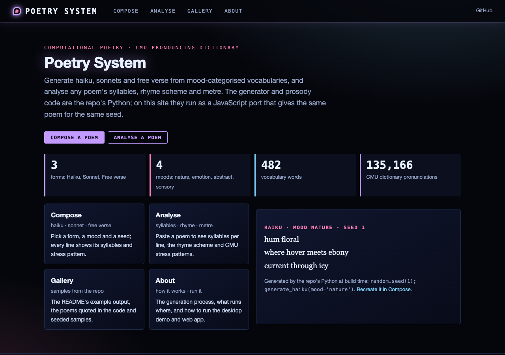
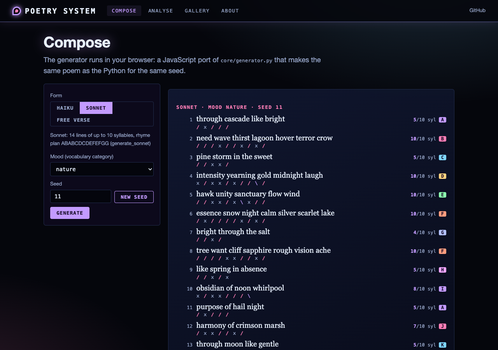
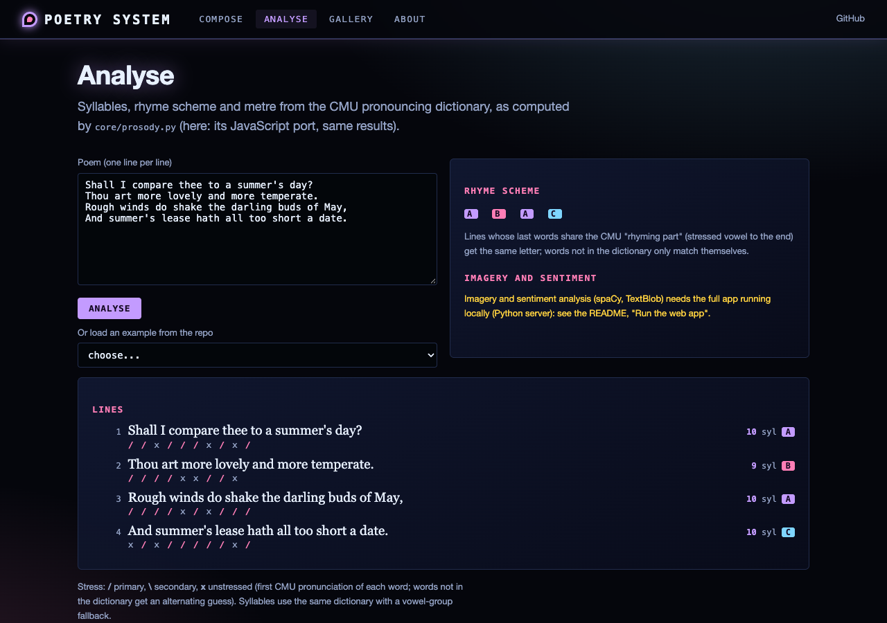
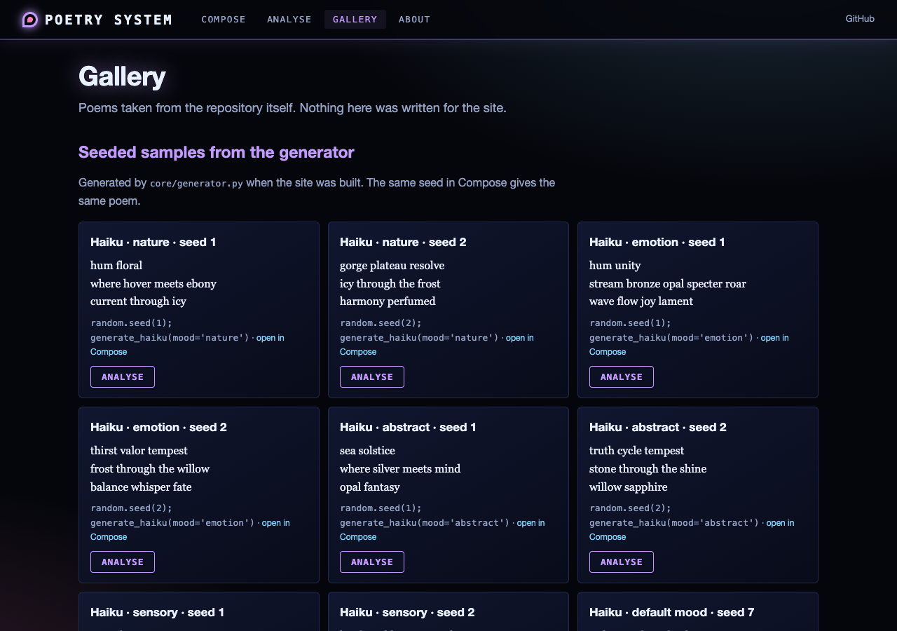

# Poetry System

An NLP-based poetry analysis and generation system using spaCy, TextBlob, and the pronouncing library. Generates haiku, sonnets and free verse with mood-based vocabulary selection (a tanka template is defined in the generator but has no `generate_tanka` method yet).

## Features

- **Poetry generation** -- haiku, sonnet, free verse
- **Poetry analysis** -- meter (per-line CMU stress patterns), rhyme scheme, sentiment, imagery detection
- **Mood-based generation** -- nature, emotion, abstract, sensory (the four vocabulary categories)
- **Syllable counting** using the pronouncing library (CMU dictionary)
- **Vocabulary system** with mood-categorized word lists

## Requirements

- Python 3.7+
- spacy, textblob, pronouncing

```bash
pip install spacy textblob pronouncing
python -m spacy download en_core_web_sm
```

## Usage

```python
from core.analyzer import PoetryAnalyzer
from core.generator import PoetryGenerator

analyzer = PoetryAnalyzer()
generator = PoetryGenerator(analyzer)

# Generate poems
print(generator.generate_haiku(mood='nature'))
print(generator.generate_free_verse(mood='emotion'))
```

```bash
python main.py
```

## Project Structure

```
poetry_system/
├── __init__.py
├── main.py                # Example usage and demo
├── setup.py               # Package setup
├── core/
│   ├── prosody.py         # syllables, rhyme scheme, meter (no spaCy needed)
│   ├── analyzer.py        # PoetryAnalyzer (adds imagery and sentiment)
│   └── generator.py       # PoetryGenerator (haiku, sonnet, free verse)
├── vocabulary/            # Mood-categorized word lists
├── web/                   # FastAPI web app + static front end (run_web.py)
├── scripts/               # static-site build, screenshots, JS fixture
└── simple-version/        # Simplified standalone version
```


## Web interface and static site

Live site (after the first push to `main`): https://gddickinson.github.io/poetry_system/

| Home | Compose |
|---|---|
|  |  |
| **Analyse** | **Gallery** |
|  |  |

Pages: **Compose** (haiku, sonnet, free verse; mood and seed), **Analyse** (paste a poem: syllables per line, rhyme
scheme, stress patterns; imagery and sentiment on the local app), **Gallery** (the README example output, the poems
quoted in the code and seeded samples), **About**.

### Run the web app

```bash
pip install -r requirements-web.txt
python run_web.py            # http://127.0.0.1:8139
```

spaCy, TextBlob and `en_core_web_sm` are optional for the web app: install them (see Requirements) to get imagery and
sentiment on the Analyse page.

### Static site

`python scripts/build_static.py` writes `site/`, published to GitHub Pages by `.github/workflows/pages.yml` on every
push to `main` (one-time setup: Settings -> Pages -> Source: GitHub Actions). On the static site the generator and the
syllable, rhyme and metre code run in the browser as a JavaScript port (`web/static/pyrandom.js`, `prosody_engine.js`,
`generator_engine.js`) that reproduces Python's `random` and gives the same poem as the Python for the same seed;
`web/static/engine.test.mjs` checks this against `tests/fixtures/poem_fixture.json`
(regenerate with `python scripts/make_poem_fixture.py`). Imagery and sentiment need the local app.

```bash
python -m pytest -q tests/test_web.py tests/test_prosody.py   # web, fixture and JS-engine tests (no spaCy needed)
python -m pytest -q                                            # everything (needs spaCy + en_core_web_sm)
```


---
*Built with AI assistance from [Claude (Anthropic)](https://claude.com/).*
